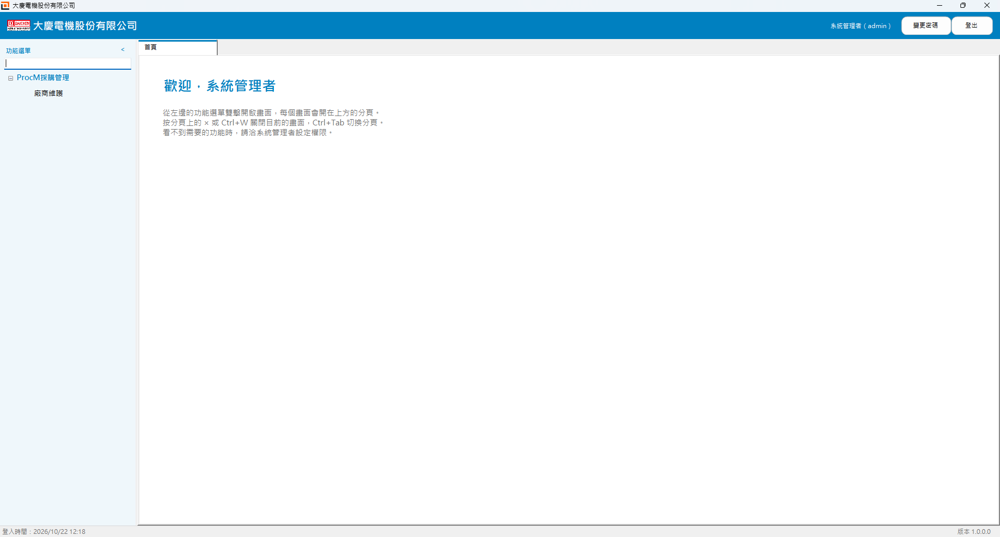
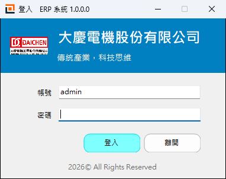

# ERP 系統（ERPClient）

ERP 系統是給一般使用者的程式，用 WinForms（.NET 8）寫成。使用者登入後，左邊會依權限列出功能選單，雙擊就把畫面開在右邊的分頁。這些畫面是管理者用 ERP Studio（[FormBuilder](../FormBuilder)）設計並發布的。



## 功能

- **登入**：帳號密碼登入，錯太多次會鎖定；第一次登入或密碼被管理者重設後，要先改密碼。登入後也可以按「變更密碼」。
- **功能選單**：依「選單管理」排好的樹狀選單，只顯示有「開啟」權限的畫面，沒有畫面的資料夾不顯示。
  - 可以搜尋功能名稱（Ctrl+F）。
  - 按 `<<` 收起選單，按 `>>` 再展開。
- **分頁**：每個畫面開在一個分頁裡，可以同時開好幾個；Ctrl+W 關閉目前的分頁。畫面裡有還沒存的輸入時，關閉前會先詢問。
- **權限**：新增、編修、刪除、核准、報表、輸出等權限在畫面裡照樣生效。
- **企業識別**：上方橫幅的顏色、標題、標誌，跟登入畫面用同一份設定（由 ERP Studio 的「企業識別」編輯）。
- **登出**：回到登入畫面，可以換另一個帳號登入。
- **自動更新**：啟動時檢查更新來源資料夾，有新版就問使用者要不要更新。



## 跟 ERP Studio 的關係

| | ERP Studio（`FormBuilder/`） | ERP 系統（`ERPClient/`） |
|---|---|---|
| 誰用 | 系統管理者 | 一般使用者 |
| 畫面設計、列印樣板 | 有 | 沒有 |
| 使用者與權限、選單、稽核紀錄、企業識別 | 有 | 沒有 |
| 系統設定（選系統資料庫） | 有 | 沒有，要由管理者或 IT 設定 |
| 開啟畫面 | 主選單 | 功能選單 + 分頁 |

ERPClient 本身只有外框（`ErpShellForm`）和啟動流程（`Program.cs`）。執行畫面、單筆編輯視窗、列印、登入、權限、系統資料庫、自動更新等程式，是在 `ERPClient.csproj` 裡用 `..\FormBuilder\` 的相對路徑直接連結 FormBuilder 的原始檔編譯的，兩邊共用同一份程式碼。畫面設計器和系統管理工具不會編進來。

所以 `ERPClient/` 和 `FormBuilder/` 兩個資料夾一定要放在同一層。

## 系統需求

- Windows 10 / 11
- 開發：.NET 8 SDK（`net8.0-windows`）
- 系統資料庫：SQL Server，要先用 ERP Studio 設定好（建立資料表、管理者帳號、發布畫面、排選單、設定權限）

## 建置與執行

在儲存庫根目錄（`ERPClient/` 和 `FormBuilder/` 的上一層）建置：

```bash
dotnet build ERPClient/ERPClient.csproj
```

```bash
dotnet run --project ERPClient/ERPClient.csproj
```

啟動流程：

1. 檢查更新：更新來源有新版時，問使用者要不要更新。
2. 讀取系統資料庫連線：還沒設定時會顯示「請洽系統管理者」，然後結束。
3. 登入。
4. 開啟 ERP 外框，按「登出」回到登入畫面。

## 系統資料庫連線

ERP 系統不提供系統設定畫面，連線設定跟 ERP Studio 共用 `%ProgramData%\ERPStudio\config.json`。在使用者電腦上可以用兩種方式設定：

- **用 ERP Studio 設定**：在同一台電腦開一次 ERP Studio，跑完系統設定精靈。連線密碼會用 Windows DPAPI 加密。
- **由 IT 放設定檔**：在 ERPClient.exe 旁邊放一份 `config.json`，會優先使用。

## 發布新版本

版本號在 `ERPClient.csproj` 的 `<Version>`。發布腳本放在 FormBuilder 那邊，在 `FormBuilder/` 資料夾用 PowerShell 執行：

```powershell
.\installer\build-release.ps1 -Project ERPClient -Version 1.0.1 -Notes "更新說明" -UpdateShare "\\server\ERPStudio\release"
```

輸出在 `FormBuilder/release-client`。有給 `-UpdateShare` 時，檔案會放到共用資料夾的 `ERPClient` 子資料夾。使用者電腦的「更新來源」設成同一個共用資料夾，下次啟動就會自動更新。有安裝 Inno Setup 6 時，也會用 `installer/ERPClient.iss` 製作安裝程式。

## 檔案

```
ERPClient/
├─ ERPClient.csproj          專案檔：連結 FormBuilder 的共用原始檔
├─ Program.cs                啟動流程（更新 → 連線檢查 → 登入 → 外框）
└─ ErpShellForm.cs           ERP 外框（使用者資訊、功能選單、分頁）
```

更完整的功能說明請看 [FormBuilder/README.md](../FormBuilder/README.md)。
