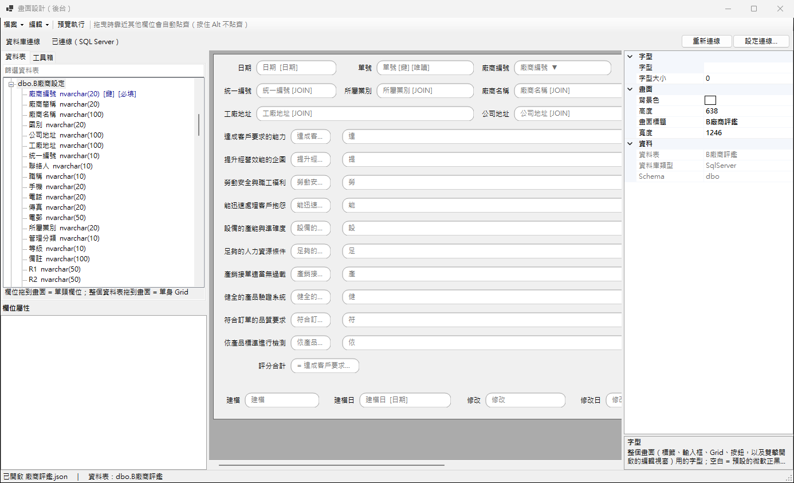
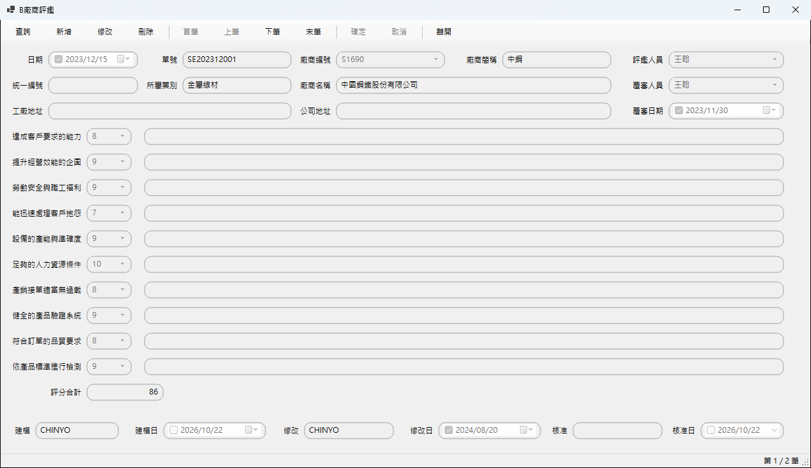
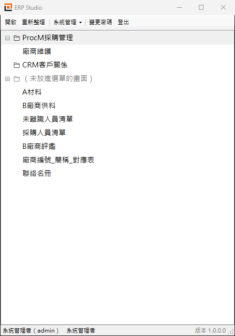

# ERP Studio（FormBuilder）

類似 4GL 的畫面設計器與執行器，用 WinForms（.NET 8）開發。

管理者在後台連上資料庫，把資料表欄位拖到畫面上，就能做出查詢、新增、修改、刪除的維護畫面，不用寫程式。畫面存成 JSON 定義檔，發布後使用者登入 ERP 系統，依權限從選單開啟使用。



## 功能

### 畫面設計（後台）

- **連線資料庫**：支援 SQL Server、Oracle（12c 以上）、MySQL。連線字串由連線設定視窗組成，畫面上只顯示遮住密碼的連線字串。
- **拖拉欄位**：從資料表清單把欄位拖到畫面上，會依資料型別建立文字框、勾選框或日期。可以改成下拉選單（固定選項或選項 SQL）、選項按鈕、日期選擇。
- **單頭 / 單身**：第一個放上來的欄位決定單頭資料表；把整個資料表拖上來就是單身 Grid，再設定和單頭的關聯欄位。
- **單頭清單、SQL 清單**：查詢結果可以用清單顯示，也可以放一個資料來自自訂 SELECT 的唯讀清單（`@單頭欄位` 取目前這筆的值）。
- **JOIN**：Grid 可以 LEFT JOIN 其他資料表，帶出唯讀欄位（例如用品號帶出品名）。
- **編輯視窗版面**：設計雙擊 Grid 某一列時跳出的單筆編輯視窗，裡面還可以放明細清單和按鈕。
- **欄位規則**：
  - 必填
  - 預設值，例如 `TODAY()+7`、`USER()`、`{使用者名稱} 建立`
  - 編號規則，例如 `[BF][YYYY][MM][DD][XXX]` → `BF20240131001`
  - 計算欄位公式，例如 `(數量 * 單價) * 0.95`
- **按鈕**：從工具箱拖進畫面，可以設定的動作有：
  - 內建動作：查詢、新增、修改、刪除、首筆～末筆、確定、取消、單身、離開
  - 執行 SQL（`@欄位名稱` 帶入目前這筆的值，整段在同一個交易裡）
  - 開啟畫面、自訂查詢、開啟查詢條件畫面（可選全部符合或任一符合）
  - 列印報表
- **列印樣板**：放文字、欄位、圖片、線條、方框和明細表格，存成 `*.print.json`，執行時依樣板預覽列印。
- **設計輔助**：對齊工具（靠左 / 置中 / 等距 / 同寬…）、拉框圈選、Ctrl+Z / Ctrl+Y 復原、圓角外觀、畫面底色、按鈕圖示與顏色。

### 執行畫面（使用者端）



- **查詢**：在欄位輸入條件後按確定。文字欄位可用 `*`、`?` 萬用字元，日期欄位只比對日期。最多取 5000 筆。
- **瀏覽**：首筆、上筆、下筆、末筆切換，或在清單點選。
- **維護**：新增、修改、刪除，有單身時會連同明細一起刪。
- **單身**：在 Grid 編輯明細，按確定時新增、修改、刪除在同一個交易裡完成，任何一筆失敗就全部不變。
- **單筆編輯**：雙擊清單開啟編輯視窗，清單可以多選，同時開多個編輯視窗。
- **參數化**：所有 SQL 都用參數傳值，不會把使用者輸入的值直接拼進 SQL。

### 系統管理



- **登入**：帳號密碼登入，錯太多次會鎖定；第一次登入或密碼被重設後要先改密碼。
- **使用者、角色與權限**：每個角色對每個畫面可以設定開啟、編修、核准、報表、輸出權限。
- **選單管理**：用資料夾把已發布的畫面排成樹狀選單。
- **稽核紀錄**：依日期、使用者、畫面、動作篩選，可以匯出 CSV。
- **企業識別**：登入畫面和 ERP 外框的標題、標誌、顏色、頁尾。
- **自動更新**：啟動時檢查更新來源資料夾，有新版就問使用者要不要更新。

## 兩個程式

| 程式 | 專案 | 誰用 | 內容 |
|---|---|---|---|
| ERP Studio | `FormBuilder`（本專案） | 系統管理者 | 畫面設計、列印樣板、使用者與權限、選單、稽核紀錄、系統設定 |
| ERP 系統 | `ERPClient`（另一個專案，參考本專案） | 一般使用者 | 登入後依權限從選單開啟畫面（分頁顯示） |

兩個程式共用同一個系統資料庫和本機設定（`%ProgramData%\ERPStudio\config.json`）。

> `ERPClient` 專案不在這個儲存庫裡，它放在原本大專案的 `ERPClient` 資料夾，用專案參考引用 FormBuilder。

## 系統需求

- Windows 10 / 11
- 開發：.NET 8 SDK（`net8.0-windows`）、Visual Studio 2022 或 `dotnet` CLI
- 系統資料庫：SQL Server（存帳號、權限、選單、已發布畫面、稽核紀錄、設定）
- 業務資料庫（畫面連的資料表）：SQL Server、Oracle 12c 以上或 MySQL
- 製作安裝程式（選用）：Inno Setup 6

## 建置與執行

在專案資料夾建置：

```bash
dotnet build FormBuilder.csproj
```

不帶參數執行會進入 ERP Studio：檢查更新，第一次使用時跑系統設定精靈，然後登入、開啟主選單。只有系統管理者能登入。

```bash
dotnet run --project FormBuilder.csproj
```

開發時可以直接開設計視窗，不用登入，畫面定義檔從檔案讀寫：

```bash
dotnet run --project FormBuilder.csproj -- --designer
```

其他啟動參數：

| 參數 | 說明 |
|---|---|
| （無） | ERP Studio：更新檢查 → 系統設定（第一次）→ 登入 → 主選單 |
| `--designer` | 直接開畫面設計視窗（開發用，不登入） |
| `--user [資料夾]` | 舊的畫面清單：列出資料夾裡的畫面定義檔，雙擊開啟（不登入） |
| `畫面.json` | 直接開啟這個畫面定義檔（不登入） |

Visual Studio 的 `Properties/launchSettings.json` 已經有「ERP Studio」和「畫面設計」兩個啟動設定檔。

> 如果 FormBuilder.exe 正在執行、建置時檔案被鎖住，可以輸出到其他資料夾：`dotnet build FormBuilder.csproj -o <暫存資料夾>`。

## 第一次使用

1. 啟動 ERP Studio，系統設定精靈會出現。
2. 選系統資料庫（SQL Server），按建立資料表。會建立 `SYS_User`、`SYS_Role`、`SYS_UserRole`、`SYS_Permission`、`SYS_Form`、`SYS_Menu`、`SYS_AuditLog`、`SYS_Setting`。
3. 系統資料庫還沒有帳號時，建立第一個管理者帳號。
4. （選用）設定自動更新的來源資料夾。
5. 登入後到「系統管理」設計畫面、發布、排選單，再設定使用者與角色權限。

系統資料庫的連線存在 `%ProgramData%\ERPStudio\config.json`，密碼用 Windows DPAPI 加密。IT 也可以在執行檔旁放一份 `config.json`，會優先使用。

## 發布新版本

`installer/build-release.ps1` 會依序做這幾件事：

1. 自含式發布（win-x64，使用者電腦不用另外安裝 .NET）
2. 產生自動更新用的 `files\` 和 `version.json`
3. 有安裝 Inno Setup 6 時，製作安裝程式

```powershell
# ERP Studio（後台）
.\installer\build-release.ps1 -Version 1.0.1 -Notes "修正列印邊界" -UpdateShare "\\server\ERPStudio\release"

# ERP 系統（使用者端）
.\installer\build-release.ps1 -Project ERPClient -Version 1.0.1 -UpdateShare "\\server\ERPStudio\release"
```

版本號在 `FormBuilder.csproj` 的 `<Version>`，自動更新靠它比對新舊版本。使用者電腦的「更新來源」設成 `-UpdateShare` 指定的共用資料夾，下次啟動就會自動更新。

## 專案結構

```
FormBuilder/
├─ Forms/                 視窗
│  ├─ DesignerForm        畫面設計（拖欄位、Grid、按鈕）
│  ├─ RuntimeForm         執行畫面（查詢 / 新增 / 修改 / 刪除 / 單身）
│  ├─ RecordNavigatorDialog、RecordEditDialog   單筆編輯視窗
│  ├─ EditLayoutDialog、GridColumnsDialog、JoinDialog、SqlListDialog   Grid 與編輯視窗設定
│  ├─ PrintDesignerForm   列印樣板設計
│  ├─ LoginForm、MainMenuForm、MenuEditorForm、UserAdminForm、AuditLogForm、BrandingForm、SysSetupForm
│  └─ ConnectionDialog    資料庫連線設定（SQL Server / Oracle / MySQL）
├─ Utility/               共用邏輯
│  ├─ Models.cs           畫面定義（FormDefinition 等，存成 JSON）
│  ├─ DbDialect.cs        各資料庫的連線與 SQL 方言
│  ├─ SchemaReader.cs     讀取資料表與欄位結構
│  ├─ ButtonRunner.cs、NumberRule.cs、DefaultValue.cs、Formula.cs、QueryCondition.cs、SqlList.cs
│  ├─ PrintTemplate.cs    列印樣板
│  ├─ Sys.cs              系統資料庫、本機設定、登入狀態
│  ├─ Updater.cs          自動更新
│  └─ DesignBox / FieldBox / GridBox / ButtonBox …   設計畫面上的元件
├─ installer/             發布腳本與 Inno Setup 腳本
└─ docs/screenshots/      操作畫面截圖
```

## 支援的資料庫

| | SQL Server | Oracle | MySQL |
|---|---|---|---|
| 驅動程式 | Microsoft.Data.SqlClient | Oracle.ManagedDataAccess.Core | MySqlConnector |
| 名稱引號 | `[名稱]` | `"名稱"` | `` `名稱` `` |
| 參數 | `@p0` | `:p0` | `@p0` |
| 取前 n 筆 | `TOP n` | `FETCH FIRST n ROWS ONLY` | `LIMIT n` |
| 取回自動編號 | `SCOPE_IDENTITY()` | `RETURNING … INTO` | `LAST_INSERT_ID()` |
| 讀取結構 | `INFORMATION_SCHEMA`、`sys` | `ALL_TAB_COLUMNS` 等 | `information_schema` |

- 按鈕 SQL、自訂查詢裡寫的 `@欄位名稱`，執行時會自動轉成該資料庫的參數寫法。
- 舊的畫面定義檔沒有「資料庫類型」時，一律當成 SQL Server。
- Oracle 由觸發程序加序列產生的主鍵不算自動編號，新增後讀不回來；12c 的 IDENTITY 欄位可以。
- 系統資料庫（帳號、權限等）目前只支援 SQL Server。
